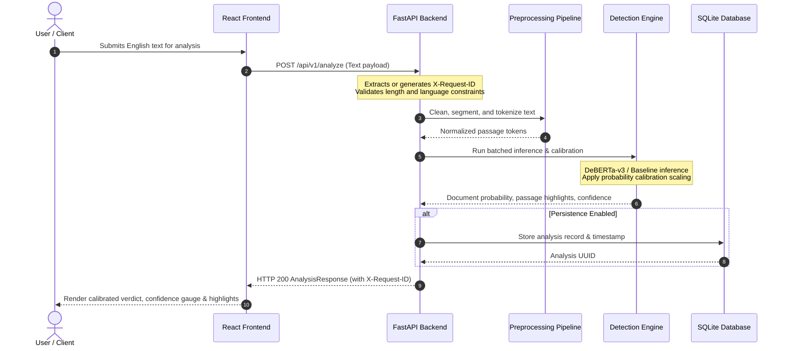

# VerityAI System Overview

This document presents the high-level system overview for **VerityAI**, detailing the implemented foundational architecture at the conclusion of Sprint 1, the planned end-to-end detection workflow, and the operational boundaries between system layers.

---

## 📌 Executive Summary

VerityAI is an English-language AI-generated text detection platform designed to distinguish human-authored text from machine-generated text using calibrated Transformer encoders and robust statistical baselines.

Unlike simplistic binary classification tools that produce ungrounded, overconfident verdicts, VerityAI is engineered around probabilistic calibration, explicit confidence intervals, passage-level attribution, and transparent limitation disclosures.

---

## 🏛️ Current Implementation vs. Planned Architecture

```
┌────────────────────────────────────────────────────────────────────────┐
│                        Current State (Sprint 1)                        │
├────────────────────────────────────────────────────────────────────────┤
│  [React 18 Frontend Shell]                                             │
│    - Vite, Tailwind CSS, TypeScript, client-side routing (React Router)│
│    - Foundational UI layout (Header, Footer, Layout, HomePage, 404)    │
│    - Status: Standalone UI shell; does NOT yet call backend API        │
├────────────────────────────────────────────────────────────────────────┤
│  [FastAPI Backend Foundation]                                          │
│    - Python 3.12, FastAPI, Pydantic Settings, Pydantic common schemas  │
│    - SQLite persistence foundation via SQLAlchemy 2.x engine & sessions│
│    - Correlation IDs (X-Request-ID) and monotonic request logging      │
│    - Liveness (/health), database readiness (/health/ready), model-info│
├────────────────────────────────────────────────────────────────────────┤
│  [Machine Learning & Inference Layer]                                  │
│    - Status: PLANNED (Not implemented in Sprint 1)                     │
│    - /api/v1/model-info reports status: "not_configured"               │
└────────────────────────────────────────────────────────────────────────┘
```

### 1. Current Architecture (Sprint 1 Completed)

The repository currently provides a validated, decoupled foundation:

1. **Frontend Web Shell**:
   - Single-page application built with React 18, TypeScript, Vite, and Tailwind CSS.
   - Provides client-side routing (`/` and `*` catch-all for 404).
   - Features accessible UI layout elements with explicit disclosures regarding the probabilistic nature of AI text detection.
   - **Boundary Note**: The frontend does not currently dispatch HTTP requests to the backend. It operates independently as a development shell.
2. **Backend API Service**:
   - Asynchronous REST API service built with Python 3.12 and FastAPI.
   - Manages environment configuration via Pydantic Settings with strong type coercion and CORS parsing.
   - Employs standardized request correlation IDs (`X-Request-ID`) tracked across async coroutines using Python `contextvars`.
   - Exposes operational endpoints:
     - Root service identification (`GET /`)
     - Process liveness check (`GET /api/v1/health`)
     - Database readiness check (`GET /api/v1/health/ready`)
     - Model metadata contract (`GET /api/v1/model-info`)
3. **Database Foundation**:
   - SQLite persistence layer managed via SQLAlchemy 2.x.
   - Provides thread-safe connection pooling, transactional session lifecycle via `get_db` FastAPI dependency, and declarative base `Base`.
   - Idempotent database initialization CLI (`python -m app.db.init_db`).
   - **Boundary Note**: No application-specific business tables (users, analysis runs, passage scores) are created yet.
4. **Automated Testing & Quality Suite**:
   - Comprehensive test suites: 39 backend tests (15 unit, 24 integration) with 91% coverage via `pytest-cov`, and 26 frontend tests with 100% coverage via `@vitest/coverage-v8`.
   - Cross-platform unified quality runner (`python scripts/run_checks.py`) enforcing tests, linting, formatting, and production builds.

---

### 2. Planned Architecture (Sprint 2 and Beyond)

When machine-learning detection pipelines and submission endpoints are introduced in later sprints, the end-to-end request flow will operate as follows:



#### Detailed Steps of Planned Flow:
1. **Input Submission**: User pastes English text or uploads a supported document into the frontend analysis workspace.
2. **Request Validation**: Backend validates payload format, verifies minimum and maximum token/word length constraints, and confirms English-language suitability.
3. **Linguistic Preprocessing**: Text is segmented into sentences and paragraphs; tokenized according to the active model candidate's tokenizer.
4. **Model Inference**:
   - Evaluated using our primary candidate (`microsoft/deberta-v3-base`) and benchmarked against comparative baselines (`roberta-base`, TF-IDF + Logistic Regression).
   - Generates raw classification logits for the full document and individual passages.
5. **Probability Calibration & Decisioning**:
   - Raw logits are transformed via calibrated temperature scaling to produce reliable probability scores.
   - Classification output categorized into:
     - **Likely AI-Generated**: High calibrated probability above decision threshold.
     - **Likely Human-Written**: Calibrated probability below decision threshold.
     - **Inconclusive**: Intermediate scores where stylistic or statistical evidence is ambiguous.
6. **Passage Highlighting**: Text spans exhibiting elevated perplexity or token probability anomalies are annotated with granular confidence tags.
7. **Response & Persistence**: Complete structured result is returned to the client and optionally persisted to SQLite for history retrieval.

---

## ⚠️ Important Limitations and Probabilistic Disclosures

AI text detection is **fundamentally probabilistic**:
- **No Definitive Proof**: Statistical features and language model perplexity patterns cannot definitively prove or disprove authorship.
- **False Positives**: Stylistically structured, formulaic, academic, or non-native English writing may be misclassified as AI-generated.
- **Evasion**: Paraphrasing, prompt engineering, adversarial insertion, or hybrid human-in-the-loop editing can alter linguistic signals to evade detection.
- **Decision Support Only**: VerityAI results are intended strictly as informative indicators for educators, editors, and reviewers, never as sole grounds for disciplinary or punitive action.
